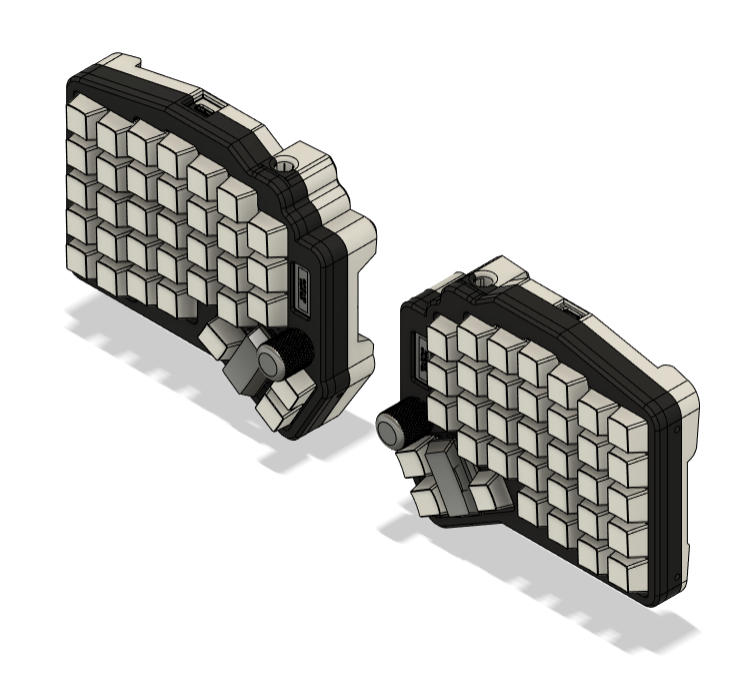
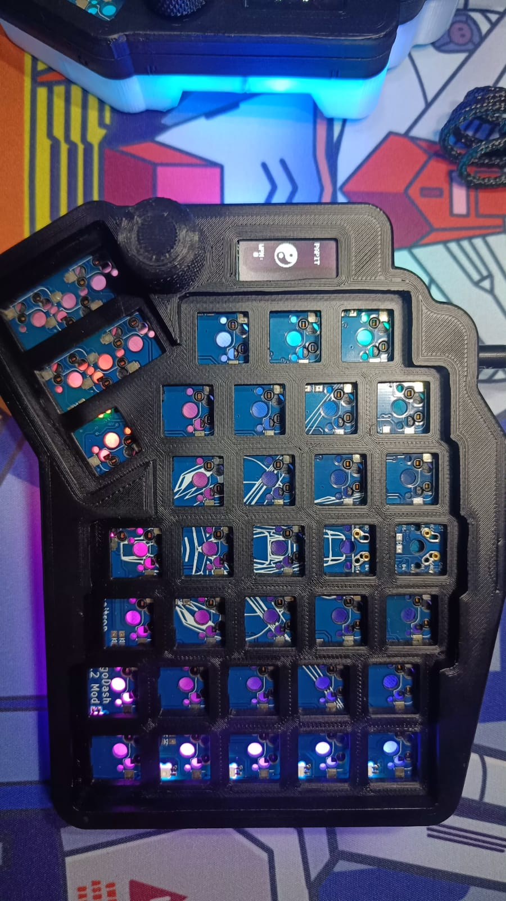
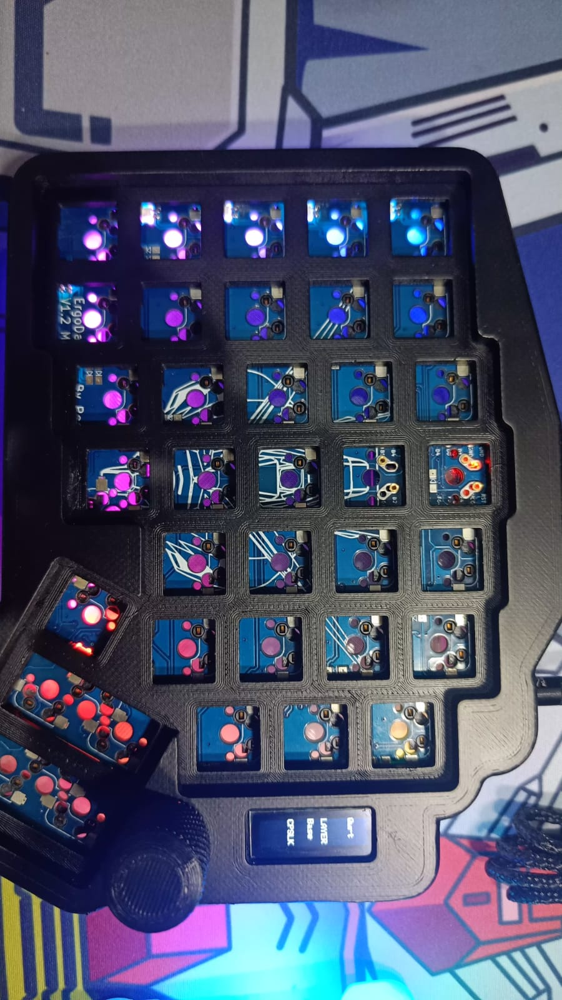
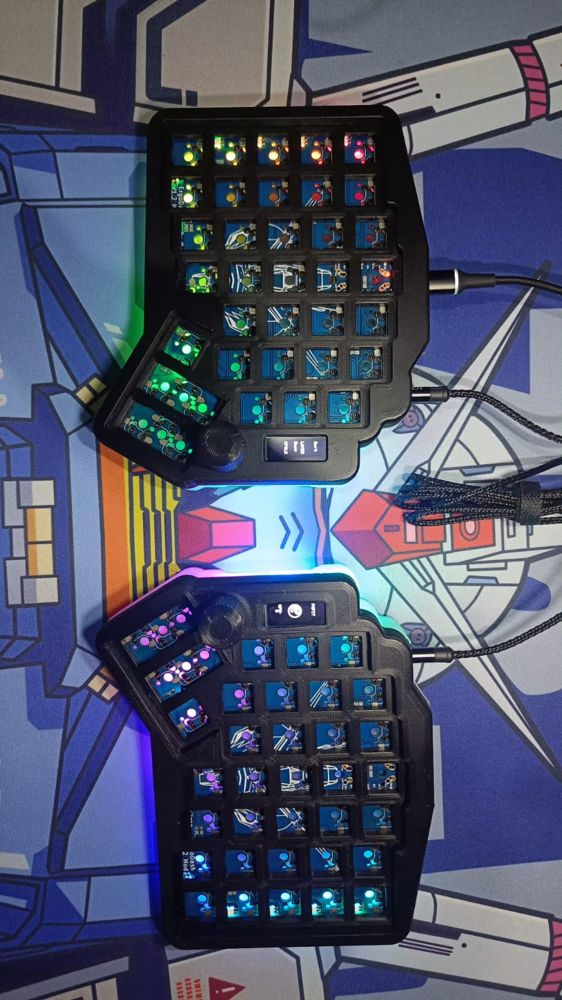

# ENCHDASH

**ENCHDASH** is an independent keyboard design derived from **ErgoDash** by omkbd. It is not an official ErgoDash revision and is not maintained, approved, or endorsed by omkbd.

**Original ErgoDash hardware:**  
Copyright (c) 2018 omkbd  
https://github.com/omkbd/ErgoDash  
Licensed under the MIT License.

**ENCHDASH modifications:**  
Copyright (c) 2024–2026 Juarendra Ramadhani  
Commercial identity: Positron Electronic

Previously sold as **ERGODASH-MOD-ENCH-OLED-QMK_VIA**. Existing units remain supported under that legacy name. See [Legacy Support](docs/LEGACY-SUPPORT.md).

---

## Table of Contents

* [Product Specification](#product-specification)
* [Hardware Revisions](#hardware-revisions)
* [Firmware](#firmware)
* [VIA Configuration](#via-configuration)
* [QMK Keycode Reference](#qmk-keycode-reference)
* [Encoder Configuration](#encoder-configuration)
* [Macros](#macros)
* [Hardware Preview](#hardware-preview)
* [Flashing Firmware](#flashing-firmware)
* [Documentation](#documentation)
* [License and Attribution](#license-and-attribution)
* [FAQ](#faq)

---

## Product Specification

- **Controller**: Arduino Pro Micro (ATmega32u4) with USB Type-C
- **Firmware**: QMK with VIA support
- **Layout**: Split ergonomic, 7×6 matrix per half
- **Features**:
  - Rotary encoder support (1 per half)
  - OLED display (128×32, master/slave split display)
  - RGB underglow (WS2812, 24 LEDs total, 12 per half)
  - Hotswap sockets (Kailh)
  - 4 layers
- **Case**: 3D-printed enclosure
- **Communication**: TRRS cable between halves

---

## Hardware Revisions

| Revision | Notes | PCB Source | Status |
|----------|-------|------------|--------|
| Rev1.2 | Current production | `Hardware/PCB/Rev1.2/` | Active |

**Safety**: Do not cross-flash firmware between unconfirmed hardware revisions. Check your PCB marking before flashing.

---

## Firmware

Three legacy firmware variants are available, all built for Rev1.2 hardware with USB VID:PID `0x4D44:0x6061`:

| Firmware | Features | VIA JSON | Download |
|----------|----------|----------|----------|
| `ergodash_rev1_via.hex` | Base: Encoder + OLED + VIA | `ErgoDash_4key_mod_positron_elektronik.json` | [FIRMWARE/](FIRMWARE/) |
| `omkbd_ergodash_rev1_nowpmmousekey.hex` | Mouse keys enabled, no WPM | `NEW_ErgoDash_4key_V3_mod_positron_elektronik.json` | [FIRMWARE/](FIRMWARE/) |
| `omkbd_ergodash_rev1_wpmnomousekey.hex` | WPM tracking enabled, no mouse keys | `NEW_ErgoDash_4key_V3_mod_positron_elektronik.json` | [FIRMWARE/](FIRMWARE/) |

**Firmware provenance**: See [FIRMWARE/manifest.json](FIRMWARE/manifest.json) for SHA-256 checksums, source paths, and build status.

**Building from source**: See [FIRMWARE/README.md](FIRMWARE/README.md) for build instructions.

---

## VIA Configuration

### Download VIA

- **Desktop**: https://github.com/the-via/releases/releases (choose your OS)
- **Web version**: https://usevia.app/

### Loading the VIA JSON

VIA may not auto-detect ENCHDASH. Load the JSON manually:

1. Connect your keyboard to PC
2. Open VIA
3. Go to **Settings** tab → enable **"Show Design Tab"**
4. Go to **Design** tab
5. Click **"Load"** and select the correct JSON:
   - `ErgoDash_4key_mod_positron_elektronik.json` for `ergodash_rev1_via.hex`
   - `NEW_ErgoDash_4key_V3_mod_positron_elektronik.json` for the other two variants
6. Go to **Configure** tab to remap keys

**If VIA does not detect the keyboard**: Verify you loaded the JSON matching your flashed firmware. USB VID:PID must match.

---

## QMK Keycode Reference

- **Keyboard keycodes**: https://github.com/qmk/qmk_firmware/blob/master/docs/keycodes.md
- **Mouse keys**: https://github.com/qmk/qmk_firmware/blob/master/docs/feature_mouse_keys.md
- **VIA keycode usage**: https://docs.keeb.io/via

---

## Encoder Configuration

Encoders are programmed through VIA using QMK keycodes in the **"Any"** key field.

**Examples**:
- `LALT(KC_TAB)` — Alt-Tab
- `LCTL(KC_C)` — Ctrl-C
- `LGUI(KC_C)` — Cmd-C / Win-C
- `LSFT(LCTL(KC_END))` — Shift-Ctrl-End
- `MO(1)` — Momentarily activate layer 1
- `LCA(KC_DEL)` — Ctrl-Alt-Del
- `MT(MOD_RSFT, KC_ENT)` — Shift when held, Enter when tapped
- `MACRO(0)` — Trigger macro 0

See https://docs.keeb.io/via for detailed encoder setup.

---

## Macros

VIA supports macro recording and playback. Resources:

- [MACRO VIA USAGE.pdf](DOC/MACRO%20VIA%20USAGE.pdf) (included in repo)
- [Keychron macro guide](https://www.keychron.com/blogs/archived/how-to-use-via-to-program-your-keyboard)
- [Video tutorial](https://youtu.be/GtSeo69Y0Zw)

---

## Hardware Preview

<p align="center">
  
  
  
  
</p>

**Video demo**: https://github.com/juarendra/Zeapad-Pro-QMK-VIA/assets/43043633/afd7e68e-0a54-4b18-be12-b96c0f13611a

---

## Flashing Firmware

### Using QMK Toolbox (Recommended)

1. Download [QMK Toolbox](https://github.com/qmk/qmk_toolbox/releases)
2. Open QMK Toolbox
3. Select the `.hex` file for your desired firmware variant
4. Connect your keyboard
5. Press the reset button (or bridge RST to GND twice quickly)
6. Click **Flash** when the bootloader is detected

### Using avrdude (Command Line)

```bash
avrdude -p atmega32u4 -c avr109 -P COM# -U flash:w:FIRMWARE/ergodash_rev1_via.hex:i
```

Replace `COM#` with your port (Windows) or `/dev/ttyACM0` (Linux/Mac).

**Backup**: Keep a working firmware `.hex` before testing new builds.

---

## Documentation

### Hardware Files

- **Schematic**: [Hardware/ErgoDash_Schematic.pdf](Hardware/ErgoDash_Schematic.pdf)
- **Dimensions**: [Hardware/Dimension_Ergodash.pdf](Hardware/Dimension_Ergodash.pdf)
- **PCB source**: [Hardware/PCB/Rev1.2/](Hardware/PCB/Rev1.2/) (KiCad 6.0+)
- **Gerber files**: [Hardware/gerber_ergodash_mod_positron.rar](Hardware/gerber_ergodash_mod_positron.rar)
- **3D case**: [Hardware/3DCase/](Hardware/3DCase/)

### Firmware Source

- **QMK source code**: [FIRMWARE/QMK/](FIRMWARE/QMK/)
- **Build guide**: [FIRMWARE/README.md](FIRMWARE/README.md)
- **Firmware manifest**: [FIRMWARE/manifest.json](FIRMWARE/manifest.json)

### Guides and Attribution

- **Legacy support**: [docs/LEGACY-SUPPORT.md](docs/LEGACY-SUPPORT.md)
- **Hardware attribution**: [docs/HARDWARE-ATTRIBUTION.md](docs/HARDWARE-ATTRIBUTION.md)
- **Third-party licenses**: [THIRD_PARTY_NOTICES.md](THIRD_PARTY_NOTICES.md)

### Manuals (Indonesian)

- [KERTAS PANDUAN ERGODASH.pdf](DOC/KERTAS%20PANDUAN%20ERGODASH.pdf)
- [TUTORIAL MEMBUAT TOMBOL PINDAH LAYER.pdf](DOC/TUTORIAL%20MEMBUAT%20TOMBOL%20PINDAH%20LAYER.pdf)

---

## License and Attribution

### Hardware

ENCHDASH hardware is derived from [ErgoDash by omkbd](https://github.com/omkbd/ErgoDash).

- **Original design**: Copyright (c) 2018 omkbd, MIT License
- **ENCHDASH modifications**: Copyright (c) 2024–2026 Juarendra Ramadhani, MIT License

See [LICENSES/MIT-ErgoDash.txt](LICENSES/MIT-ErgoDash.txt) for the full original license.

### Firmware

QMK-derived firmware is licensed under GPL-2.0-or-later. Original QMK and omkbd copyright notices are retained in source files.

- **QMK Firmware**: https://github.com/qmk/qmk_firmware
- **License**: [LICENSES/GPL-2.0-or-later.txt](LICENSES/GPL-2.0-or-later.txt)

### Third-Party Components

This repository includes footprint libraries, 3D models, and other assets under various licenses. See [THIRD_PARTY_NOTICES.md](THIRD_PARTY_NOTICES.md) for a complete inventory.

### Repository License

See [LICENSE](LICENSE) for the repository-wide license index.

---

## FAQ

### Q: Is this an official ErgoDash product?

**No.** ENCHDASH is an independent derivative. It is not maintained, approved, or endorsed by omkbd.

### Q: Can I use legacy firmware on existing units?

**Yes.** Units sold as "ERGODASH-MOD-ENCH-OLED-QMK_VIA" remain fully supported. You do not need to reflash or change VIA JSON files if your keyboard is working.

### Q: Which firmware should I use?

- **Most users**: `ergodash_rev1_via.hex` (base VIA firmware)
- **Need mouse keys**: `omkbd_ergodash_rev1_nowpmmousekey.hex`
- **Need WPM display**: `omkbd_ergodash_rev1_wpmnomousekey.hex`

### Q: VIA does not detect my keyboard

1. Ensure you loaded the correct VIA JSON file (see [VIA Configuration](#via-configuration))
2. Verify your firmware is flashed correctly
3. Try the VIA web version: https://usevia.app/

### Q: Can I build custom firmware?

**Yes.** Source code is in `FIRMWARE/QMK/`. See [FIRMWARE/README.md](FIRMWARE/README.md) for build instructions. You will need the QMK toolchain installed.

### Q: Where can I get replacement parts?

Contact **Positron Electronic** for hardware support.

### Q: How do I update to ENCHDASH-branded firmware?

Future ENCHDASH firmware will be released separately. Existing units do not require updates unless you want new features. Legacy firmware will remain available.

---

## Contact

- **Repository**: https://github.com/juarendra/ERGODASH-MOD-ENCH-OLED-QMK_VIA
- **Commercial identity**: Positron Electronic
- **Copyright holder (modifications)**: Juarendra Ramadhani

---

**Note**: This keyboard is a hobbyist project and derivative work. It carries no warranty. Use at your own risk.
